# To the Digital Side (Al Lado Digital)

User Experience Design for *To the Digital Side* (*Al Lado Digital* in Spanish)

## Index

- [1. Introduction](#1-introduction)
  - [1.1. The Problem](#11-the-problem)
  - [1.2. Our Solution](#12-our-solution)
  - [1.3. How This Repository Is Organized (UX Elements)](#13-how-this-repository-is-organized-ux-elements)
- [2. Team & Roles](#2-team--roles)
- [3. Strategy](#3-strategy)
  - [3.1. Value Proposition Canvas](#31-value-proposition-canvas)
  - [3.2. UX Personas](#32-ux-personas)
  - [3.3. Benchmarking](#33-benchmarking)
- [4. Scope](#4-scope)
  - [4.1. Scope Definition](#41-scope-definition)
  - [4.2. Customer Journey Map](#42-customer-journey-map)
- [5. Structure](#5-structure)
  - [5.1. Navigation Structure](#51-navigation-structure)
- [6. Skeleton](#6-skeleton)
  - [6.1. Low-Fidelity Wireframes](#61-low-fidelity-wireframes)
- [7. Surface](#7-surface)
  - [7.1. High-Fidelity Wireframes](#71-high-fidelity-wireframes)
  - [7.2. Interface Evolution](#72-interface-evolution)
- [8. AI Usage Log](#8-ai-usage-log)
- [9. Annex](#9-annex)

---

## 1. Introduction

### 1.1. The Problem

> I need to book a doctor's appointment online this week, and my family lives in another city.
> I don't want to give my passwords to a stranger.
> How will I know the errand was actually completed?

Many everyday errands have moved to online channels, and older adults depend on a relative being available to complete them. Peer facilitators and volunteers exist in senior citizens' clubs and municipalities, but coordination is informal (for example, WhatsApp groups) and gets lost along the way.

The challenge is well-defined and verifiable: **match a specific need with someone who can help, schedule the meeting, and record whether the errand was resolved**, building trust without exposing the requester's sensitive data.

| Gap | Description |
|---|---|
| Trust | Risk of exposing sensitive data or passwords to a stranger |
| Dependence | Constant reliance on a relative being available |
| Coordination | Informal arrangements get lost: missed appointments and postponed care |
| Uncertainty | Not knowing whether the errand was actually completed |

---

### 1.2. Our Solution

**To the Digital Side** (*Al Lado Digital*) is a platform that pairs older adults with trusted peer facilitators or volunteers to complete online errands together: in person, at an agreed time, with confirmation of the outcome, and **without sharing passwords with anyone**.

**Matching and scheduling**

- The older adult states the errand and when they are available
- Matching with a **verified** facilitator or volunteer
- Integrated scheduling: date, time and place of the meeting

**Guided in-person assistance**

- The person types their own passwords; the volunteer only accompanies them
- Verified profiles within a limited, known support network

**Traceability**

- A log to verify and mark the **status of each errand**
- Peace of mind through clear, recorded confirmations

**Simple and accessible interface**

- Large text, short steps and no long forms

---

### 1.3. How This Repository Is Organized (UX Elements)

Every UX research technique in this repository sits under one of the five layers of the UX Elements model (Strategy, Scope, Structure, Skeleton, Surface), and each layer feeds the next.

| UX Element | Question it answers | Section | Techniques and deliverables |
|---|---|---|---|
| **Strategy** | Who is it for and why does it matter? | 3 | Value Proposition Canvas, UX Personas, Benchmarking |
| **Scope** | What exactly will we build, and what will we leave out? | 4 | Scope definition (1 main + 2 secondary flows), Customer Journey Map |
| **Structure** | How do people move through it? | 5 | Navigation flow and navigation structure |
| **Skeleton** | Where does each element go? | 6 | Low-fidelity wireframes |
| **Surface** | How does it look and feel? | 7 | High-fidelity wireframes, interface evolution |

> **Language note:** this documentation is written in English. At our teaching assistant's request, the text **inside the interfaces** (wireframes) is in **Spanish**.

---

## 2. Team & Roles

| Member | Role | Responsibility in this project |
|---|---|---|
| Vicente Contreras | Project Manager | Coordination, team cohesion, presentations and overall planning |
| Nelson Sandoval | UX/UI Designer | Formal deliverables (flows, wireframes, interfaces); keeps the [AI Usage Log](docs/ai-usage-log.md) up to date |
| Arturo Rivas | UX Researcher / Analyst | Benchmark, interviews and notes, and the conceptualization of needs |

---

## 3. Strategy

### 3.1. Value Proposition Canvas

*How we aligned the needs of older adults with our solution*

**Customer segment:** older adults who need to complete errands online and do not always have someone available to help them.

**Identified gaps:**

- **Trust:** the risk of exposing sensitive data or passwords to a stranger.
- **Dependence:** constant reliance on relatives being available.
- **Coordination:** informal arrangements that get lost, causing missed appointments and postponed care.
- **Uncertainty:** not knowing whether the errand was actually completed.

**How the solution responds:**

- **Pain relievers:** passwords are never shared, volunteers have verified profiles, and the support network is limited and known.
- **Gain creators:** peace of mind through recorded confirmations, and the chance to complete the errand on their own with guided assistance.

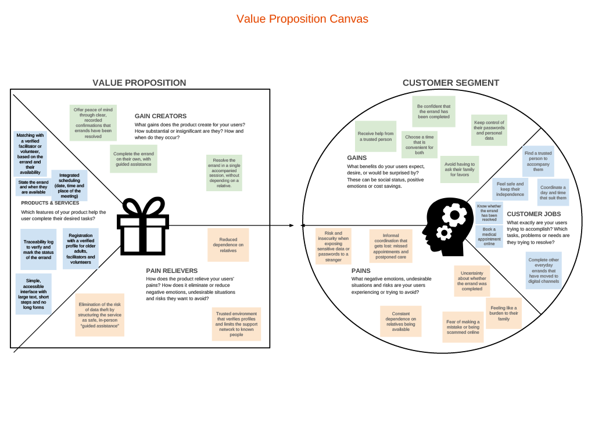

---

### 3.2. UX Personas

*Three personas represent the three roles that the interfaces serve: the older adult who requests help, the volunteer who accompanies her, and the municipal coordinator who oversees the network.*

**What they are based on.** These are **proto-personas based on team assumptions**. **They have not yet been validated through interviews**; the next step is to validate them with older adults from a senior citizens' club, club volunteers and a municipal coordinator, and to revise the personas with what we learn. We state this limit openly so that nobody reads the quotes, emotions or indicators as research findings.

| Persona | Role | Key need | Digital level |
|---|---|---|---|
| **Celia Márquez**, 74, retired | Requester (primary persona) | Get help from someone she trusts without handing over her passwords | Low |
| **Roberto Pérez**, 67, retired | Volunteer and club peer facilitator | An ordered, simple way to know whom to help and when | Intermediate |
| **Andrés Rivera**, 40 | Municipal coordinator (desktop) | See on one screen who is waiting for help today and who is attending them | Medium-high |

> *"My children live far away and I don't want to bother them every time I need to book an appointment. If someone from the club goes with me, I'll do it myself, but I'm not giving my passwords to just anyone."* — Celia

> *"I learned to use the government portal on my own. If you give me a simple app without so many hoops, I'm happy to go with the other club members to get their things done."* — Roberto

> *"I can't rely on volunteers' good memory. I need to see on a screen how many seniors are waiting for help today and who is taking care of them."* — Andrés

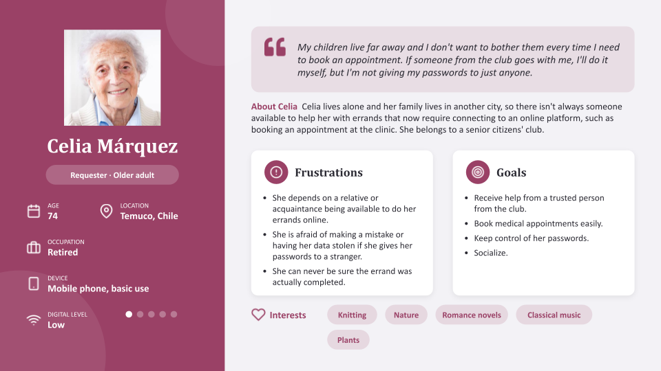

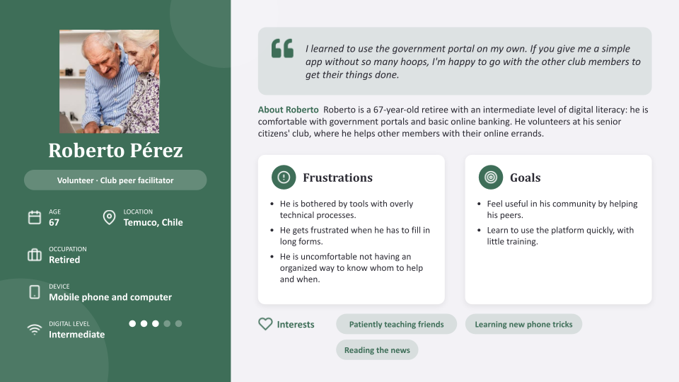

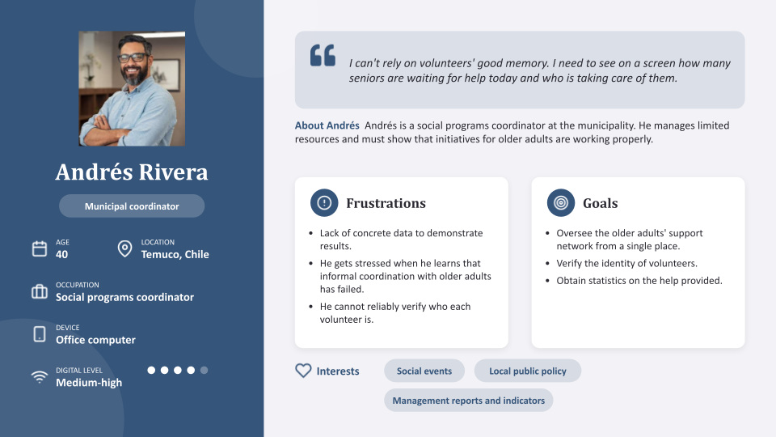

A fourth proto-persona (Sofía Morales, 24, student volunteer) was developed in an earlier version. She has the same role as Roberto, so she uses the same volunteer screens. To keep the persona set to the three that drive the design decisions, she is shown in the [Annex](#9-annex) as a secondary persona.

---

### 3.3. Benchmarking

To identify best practices and opportunities for improvement in the design of *To the Digital Side*, we analyzed three existing tools that cover the problem space: older adults completing everyday errands online.

#### Tools analyzed

| Tool | Type | Version / platform | Why it was chosen |
|---|---|---|---|
| **Espacio Mayor** (Fundación Conecta Mayor UC) | Direct competitor and design reference | v0.0.48, Android | Same profile and the same problem (online errands). Closest to our proposal, but with no in-person human help. Visual reference for its large text and icons |
| **App Mayor** (Fundación Conecta Mayor UC) | Complementary | v2.2.9, Android | Makes the phone easier to use and gives direct access to ChileAtiende by video call and phone, but does not complete errands |
| **ChileAtiende** | Analogous | Mobile website | The State's portal: the same errands for the general population. Shows how booking works today and which assisted channels exist |

#### How we explored them

For each tool we recorded **"the good"** and **"the bad"**, each backed by an annotated screenshot and, for the problems, a usability heuristic (Nielsen). We then summarized the findings with the **four-action model** (Increase, Include, Reduce, Remove).

| Tool | The good | The bad (heuristic) |
|---|---|---|
| **Espacio Mayor** | Large cards with image, bold title and short description. Bottom bar with icons and text. "Back" button with text | Titles cut off with "…" (recognition rather than recall). Sends the user to an external site that asks for national ID and ClaveÚnica **without warning**; without ClaveÚnica the flow ends (help and documentation; visibility of system status) |
| **App Mayor** | Modal with three large, named actions and a clear "Close". One-tap call to the 101 line (shortest path to human help) | Video service closed, and the user only finds out after entering (visibility; error prevention). Huge buttons but tiny text in the embedded web (consistency). Colors with no consistent meaning (consistency) |
| **ChileAtiende** | "Network of service points" menu split into in-person and remote. Step indicator with the current step highlighted. Calendar that disables unavailable days, plus a summary before confirming | Very small text (minimalist design; accessibility). Too many steps and a change of subdomain and brand (user control; consistency). reCAPTCHA and personal data with no contextual help (help and documentation) |

| **Increase** | **Include** | **Reduce** | **Remove** |
|---|---|---|---|
| Large buttons and text | Bottom bar with icons and labels | Small text and long access paths | Colors with no consistent meaning |
| Explicit actions in a modal | One-tap direct call | Truncated titles | Leaving for an external site without warning |
| Cards with image and short description | Visible assisted alternatives | Small web text inside an app | Finding out a service is closed only after entering |
| Step indicator when booking | **Human accompaniment at the moment of ClaveÚnica** (our differentiator) | | |

> The tools we analyzed help older adults on their own, through simplified interfaces or through the State's service channels (video call, call center and branches). None of them offers guided help from a trusted peer who accompanies the person while they type their own passwords, and that is the gap *To the Digital Side* addresses.

**Clarifications and restrictions**

- All three tools were analyzed on **October 3, 2026**, from the team's own screenshots, in the versions listed above. Later versions may differ.
- The analysis is based on screens only. **It was not tested with users.**
- Play Store screenshots were used only as a reference and not as evidence. Findings that we could not confirm on the screens were discarded.
- ChileAtiende's color contrast was measured at **5.7:1**, which is enough. The problem there is the **size** of the text, not the contrast.
- A "Companion Center" mentioned in a UNDP note could not be confirmed, so it is not part of the analysis.

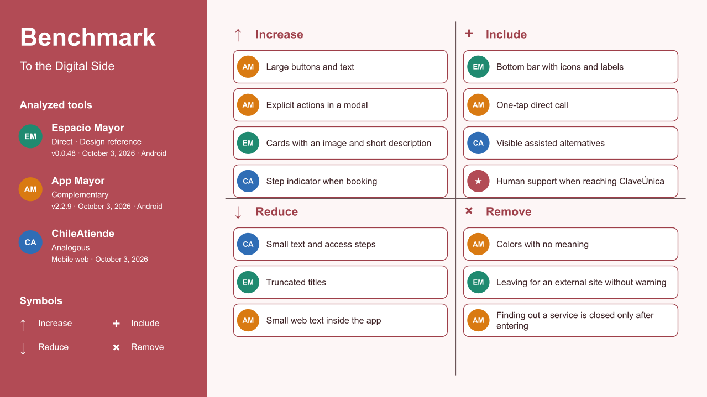

For the complete analysis with annotated screenshots, see the [benchmark document](docs/benchmark-en.pdf).

---

## 4. Scope

### 4.1. Scope Definition

The solution is limited to **one main flow and two secondary flows**. Together they cover the whole life of one errand, from the request to its confirmed result, once, for each of the three roles. Everything else is deliberately left out (see the table below), because a design with many options and no hierarchy would hide the one thing we want to prove: that an older adult can get help from a trusted person **without ever handing over her passwords**.

| Flow | Role | Screens | Why it is in scope |
|---|---|---|---|
| **Main flow: ask for help and accept a companion** | Older adult (Celia) | A1, A1m, A2, A3, A4, A5, A6, A6m, A7, A8, A8m (11) | It contains the moment our proposal is about: the older adult asks, trusts a verified person and opens the official site herself. It also contains the emotional low point of the journey (Decision) and the three trust screens |
| **Secondary 1: propose a meeting and close the errand** | Volunteer (Roberto) and older adult | B1, B2, B3, C1, C2, C3, C4 (7) | Without someone who answers the request and without a recorded result, the main flow never ends. This is where the uncertainty gap is closed |
| **Secondary 2: follow up on cases** | Municipal coordinator (Andrés) | D1, D2 (2) | The coordinator needs to see who is waiting and who is attending. This is what replaces the informal WhatsApp coordination |

**What is left out, and why**

| Left out | Reason |
|---|---|
| Sign-up and log-in | Shown in the navigation flow but not wireframed. The access method (club link, code or password) is still undecided, and we want to avoid adding another password for older adults to remember. It does not change the core value being tested |
| Volunteer profile and weekly availability ("My profile" tab) | In the prototype, matching is shown by filtering the requests that fit the person. The tab appears in the bar for consistency but opens nothing |
| Verification of volunteers (identity, records, training) | The municipality does it outside the app. The screens only show the "Verified by the municipality" badge as a given. What exactly is verified is still to be defined |
| Coordinator tabs "Requests" and "People and verification", and registering an older adult on her behalf | Out of the core path: D1 already lists every request and D2 gives the case history. Manual assignment by the coordinator was replaced by volunteers proposing meetings from their own network |
| Statistics and KPIs | They need real usage data that does not exist yet |
| Reminder and notification engine | Shown only as system events (dashed arrows in the flow), not as screens |
| Notifying relatives | Removed on purpose: it is not in the Canvas, and Celia wants to depend less on her family |
| Chat and video call | A one-tap call replaces the chat so we do not recreate the confusion of WhatsApp groups. A video call is not in-person help |
| Free search of errands | The prototype offers four errands only, so a search box would add nothing (also a weakness we saw in Espacio Mayor) |
| Payments, ratings and favorites | Not needed to answer the problem |

**Traceability: from the Canvas to the screens**

| Pain identified in the Canvas | What the product does | Screens |
|---|---|---|
| Risk of giving passwords to a stranger | Reassurance on sensitive screens, official site named and announced, verified volunteers | A4, A6, A8, A8m, C1 |
| Dependence on relatives | The older adult asks for help and accepts a companion by herself, in three short steps | A1 to A4, A6 |
| Informal coordination that gets lost | Requests list for the network, meeting proposal with day, time and place, coordination dashboard | A5, B1 to B3, D1 |
| Uncertainty about whether it was completed | Result in one tap, confirmation by the older adult, list of errands with status | C2 to C4, D2 |

---

### 4.2. Customer Journey Map

We combined the persona **Celia Márquez** with the features of the project to map how she would experience the service, from hearing about it to asking for help again.

**Scenario:** book a doctor's appointment online this week, with help from a club volunteer and without handing over her passwords.

The map follows five stages:

- **Awareness:** she hears about the service at her senior citizens' club.
- **Consideration:** she checks that the people are verified and trustworthy.
- **Decision:** she creates her profile and states the errand she needs.
- **Delivery & Use:** she meets her facilitator or volunteer, types her own passwords and completes the errand.
- **Loyalty & Advocacy:** she checks the status of the errand, asks for help again and tells her club peers.

For each stage, the map covers the customer's activities, goals, touchpoints, emotions, pains and the solutions in *To the Digital Side*, as well as the business goal, KPIs, organisational activities, responsible parties and technology systems behind it.

> The emotions and indicators are hypotheses based on proto-personas, to be validated with real users.

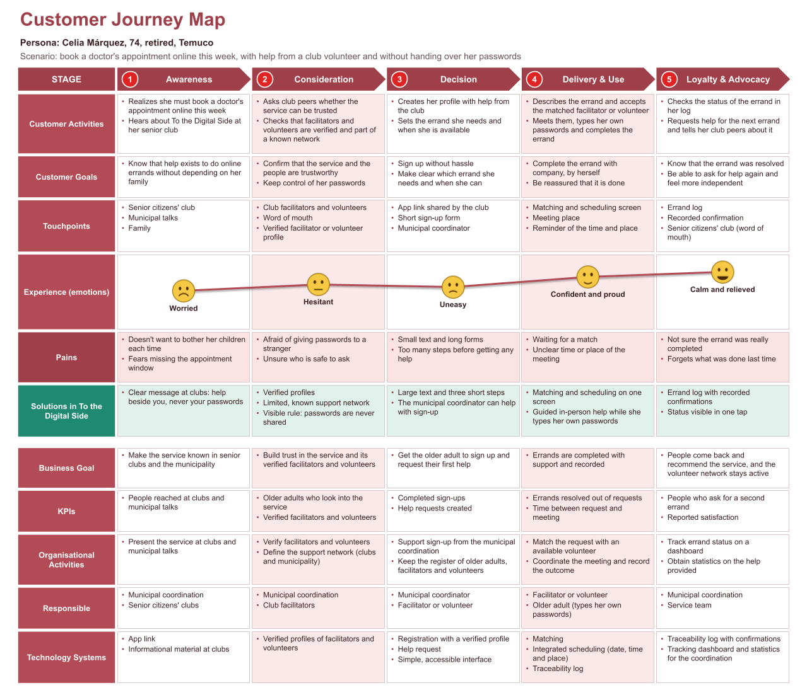

---

## 5. Structure

### 5.1. Navigation Structure

The product is a **mobile app** with three sets of screens, one per role. The older adult and the volunteer each get a bottom bar with **three tabs and a text label under every icon**, a pattern we adopted from Espacio Mayor. The municipal coordinator works from a **desktop view**, because Andrés uses an office computer (a persona assumption).

| Role | Persona | Platform | Main navigation |
|---|---|---|---|
| Older adult (requester) | Celia Márquez | Mobile | *Inicio* (Home) · *Mis ayudas* (My errands) · *Ayuda* (Help) |
| Volunteer / peer facilitator | Roberto Pérez | Mobile | *Solicitudes* (Requests) · *Mi agenda* (My schedule) · *Mi perfil* (My profile, out of scope) |
| Municipal coordinator | Andrés Rivera | Desktop | *Hoy* (Today) · *Solicitudes* (Requests, out of scope) · *Personas y verificación* (People and verification, out of scope) |

**Flows** (screen codes match the wireframes in sections 6 and 7, and the scope in [4.1](#41-scope-definition)):

1. **Main flow. Older adult: ask for help and accept a companion.** `A1` Home → `A2` Choose the errand → `A3` Choose days and time → `A4` Review and send → `A5` Request sent → `A6` Accept the proposed meeting (or `A6m` ask for someone else) → `A7` Meeting confirmed → `A8` Day of the meeting → `A8m` Notice before leaving for the official site. `A1m` (talk to a person) opens from Home, and the same help option appears on the day-of-meeting screen.
2. **Secondary 1. Volunteer and older adult: propose a meeting and close the errand.** `B1` Requests from the network → `B2` Propose a meeting → `B3` My schedule → `C1` Meeting → `C2` How did it go? When the volunteer reports the result (resolved or needs follow-up), `C3` asks Celia to confirm it; either answer leads to `C4` My errands, where "ask again" reopens `A3`.
3. **Secondary 2. Coordinator: follow up on cases.** `D1` Coordination dashboard ↔ `D2` Case detail. The dashboard lists the requests from every lane and their status; in the prototype it has no links to or from the mobile screens.

We drew the **navigation flow** first, to decide which wireframes to design, and then designed one wireframe for every box. Following the flow, each role has its own lane, time runs from top to bottom, and the lanes line up so that you can see what each person sees at the same moment (for example, when Celia sends a request, it appears in the volunteer's list).

- **Solid arrows** are things a person taps. **Dashed arrows** are system events or actions by someone else (a proposal arriving, the agenda updating). They are not taps; in Figma, some of them are "(Prototipo)" shortcuts.
- Every solid arrow matches a link in the Figma prototype. Back buttons, "Volver al inicio" and the tab bars are listed in the diagram's notes rather than drawn.
- **Pink boxes** mark the *trust moments*: the screens that announce what an official site will ask for and make clear that the person types their own passwords.
- **Yellow dashed boxes** are outside the wireframes (see the scope): sign-up and login, and the official site that opens outside the app.

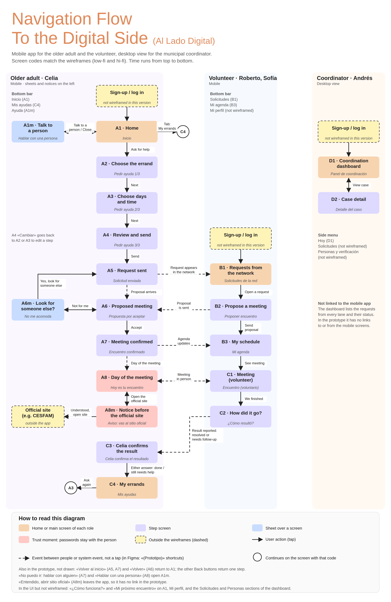

For the diagram as a document, see the [navigation flow (PDF)](docs/navigation-flow-en.pdf).

The diagram names each screen in English, while the wireframes are in Spanish. The [screen name equivalences](docs/screen-names.md) match every English name with its Spanish frame in Figma, using the shared screen code.

> The flow was read from the buttons and links in the wireframes. Screens marked "(Prototipo)" in Figma are shortcuts used to move between states in the mockup; in the real product, those transitions happen on their own (for example, a proposal arriving).

---

## 6. Skeleton

### 6.1. Low-Fidelity Wireframes

The low-fidelity wireframes fix **layout, hierarchy and content** before any visual styling. They are grayscale, use real Spanish text, and cover **20 screens** plus a component sheet:

- **Main flow, older adult (A1 to A8m, 11 screens):** home with large shortcuts and A– / A+ text-size buttons, talking to a person, a three-step request (errand, days, review), request sent, accepting or declining a proposed meeting, confirmed meeting with a checklist of what to bring, and the day-of-meeting guide.
- **Secondary 1, volunteer (B1 to C2, 5 screens):** requests from the network, proposing a day and time, personal schedule, guided meeting and a one-tap outcome ("Resolved" or "Needs follow-up").
- **Secondary 1, older adult after the meeting (C3 to C4, 2 screens):** confirming the outcome and the list of errands, with "ask again".
- **Secondary 2, coordinator (D1 to D2, 2 desktop screens):** a dashboard with requests waiting, and a case detail with history and coordination actions.

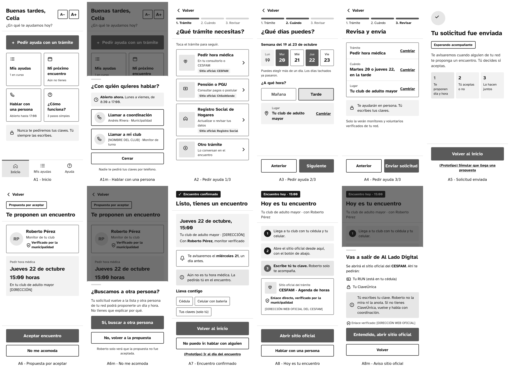

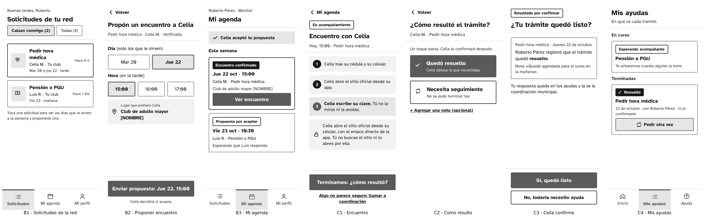

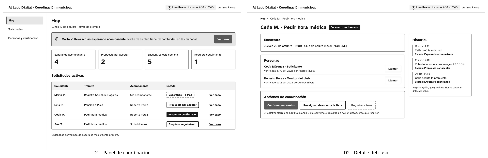

All screens and the component sheet: [low-fi wireframes (PDF)](docs/wireframes-low-fi-es.pdf)
Figma file: [Low-fi wireframes](https://www.figma.com/design/iuQ3Dh1TUHm5OsJF83BBEb/al-lado-digital__low-fi-wireframes)

---

## 7. Surface

### 7.1. High-Fidelity Wireframes

The high-fidelity version applies visual design to the same 20 screens. The design decisions that carry the most weight:

- **One accent color (orange), used only for the main action and the active item.** Everything else is neutral, so color always means the same thing (a problem we recorded in App Mayor).
- **Large text and buttons, with a text-size control (A– / A+) on the home screen.**
- **A reassurance about passwords on every sensitive screen:** "We will never ask for your passwords. You always type them yourself."
- **Official sites are named and announced before leaving the app** (`A8`, `A8m`): the screen says which site opens, what it will ask for (national ID and ClaveÚnica) and that the volunteer only accompanies.
- **Verified volunteers** show a "Verified by the municipality" badge (`A6`).
- **Familiar patterns**: bottom bar with icon and label, large cards, step indicator and a summary before sending, taken from the three tools in the benchmark.

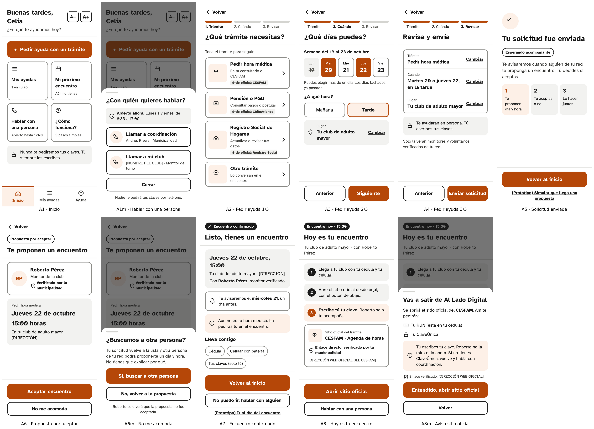

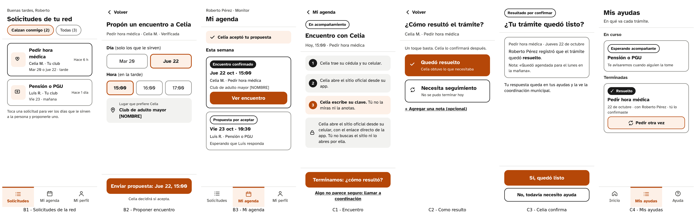

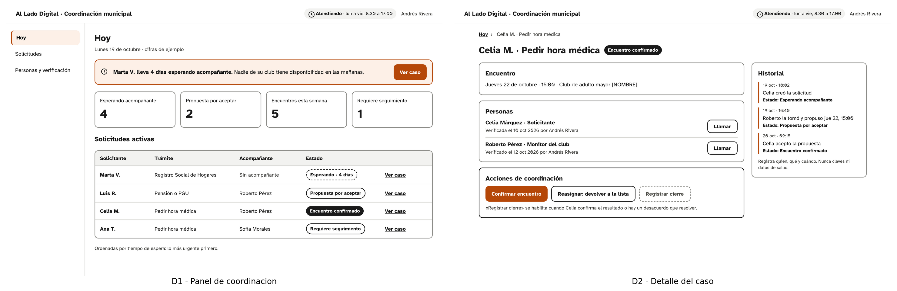

All screens and the component sheet: [high-fi wireframes (PDF)](docs/wireframes-hi-fi-es.pdf)
Figma file: [High-fi wireframes](https://www.figma.com/design/nFXlK3JkbD5MW7fky4NOvt/al-lado-digital__hd)

> The data on the screens (names, dates and figures) are examples. Some fields still show placeholders such as *[DIRECCIÓN]* and *[NOMBRE DEL CLUB]*.

---

### 7.2. Interface Evolution

#### From the Canvas to the final interface

Each pain from the Value Proposition Canvas was first given a place in the Skeleton (layout and content) and then a look in the Surface.

| Pain in the Canvas | Skeleton (low-fi) decision | Surface (hi-fi) decision |
|---|---|---|
| Fear of giving passwords to a stranger | A day-of-meeting guide that says the person types her own passwords | The reassurance on every sensitive screen, a named official site announced before leaving the app, and the "Verified by the municipality" badge |
| Dependence on relatives | A request in three short steps with a summary before sending | Large type, A– / A+ control and a single orange action per screen |
| Informal coordination that gets lost | Requests list for the network, a meeting proposal and a coordination dashboard | Proposals limited to the days and hours that suit the older adult, and a dashboard sorted by waiting time |
| Not knowing whether it was completed | One-tap result and a confirmation by the older adult | Clear status and a "Resolved" mark in *My errands*, with "ask again" |

#### What changed between version 1 and version 2 of the interfaces

We compared our screens with what the benchmark showed, and recorded **what we took, what we changed and what we stopped asking for**.

| Screen | Change in version 2 | Reason (benchmark and heuristic) |
|---|---|---|
| All | **One** accent color (orange), only for the main action and the active item | Espacio Mayor highlights the active item in orange. App Mayor's colors have no consistent meaning (consistency and standards) |
| A1 Home | **New:** large shortcuts with icon and label, A– / A+ text size, greeting | App Mayor's grid of large buttons; Espacio Mayor's text-size controls (recognition rather than recall; flexibility) |
| A1m Talk to a person | **New:** a sheet with explicit actions, with opening hours visible before calling | App Mayor's modal with named actions and one-tap call. App Mayor's video service closes without notice (visibility of system status; error prevention) |
| A2 Choose the errand | **Reduce:** cards with image, full title and official site. One tap moves forward (the "Continue" button was removed) | Espacio Mayor's cards. Its truncated titles are a problem (recognition; efficiency) |
| A2 to A4 Request steps | **Modify:** named steps, large Previous / Next buttons and a summary before sending | ChileAtiende's step indicator, large buttons and final summary (visibility; user control and freedom) |
| A3 Days and time | **Reduce:** weekly calendar with past days crossed out. The place is pre-filled (her club) with "Change" | ChileAtiende's calendar disables unavailable days. Too many steps to book is its weakness (error prevention; minimalism) |
| A6m Decline | **Reduce:** a sheet with two actions. The reasons form was removed | App Mayor's modal with large actions and a clear "Close" (minimalist design) |
| B2 Propose a meeting | **Reduce:** the volunteer chooses among options filtered by Celia's availability, instead of three lists | ChileAtiende offers only available days and hours (flexibility and efficiency) |
| A8, A8m Day of the meeting | **New:** Celia opens the official site from her own phone, with a verified direct link and a notice of what will be asked. The volunteer does not search for or open the site | Espacio Mayor sends users to an external site without warning. Our matrix adds accompaniment at ClaveÚnica (help and documentation; visibility; trust) |
| C2 Result | **Reduce:** one tap (two large buttons). The note is optional | App Mayor's large, explicitly named actions (minimalist design) |
| C4 My errands | **New:** "Ask again" on resolved errands | Espacio Mayor's favorites, to return quickly to what matters |
| D1 Dashboard | **New:** visible opening hours and an alert for requests without a companion for more than 3 days | App Mayor's closed service with no notice; Andrés's need to see who is waiting today (visibility of system status) |
| Menus | **Reduce:** shorter menus (volunteer with 3 tabs, coordination without Reports) and a filtered list ("Calzan conmigo") | Espacio Mayor's bottom bar of only three labeled icons |

**Results by the team's own count:** asking for help went from 8 decisions to 6, proposing a meeting from 7 taps to 4, and rejecting a proposal or reporting a result now takes 1 tap each (from 2).

**Not taken from the benchmark:** video call and embedded web (App Mayor), because our service is in person; free search (Espacio Mayor), because there are only four errands; reCAPTCHA and long data forms (ChileAtiende).

> These figures come from the team's own count on the version 1 and version 2 screens. **They have not been tested with users.** Still to validate with real older adults who match our personas: whether the orange accent stands out for people with low vision, whether A– / A+ is understood without explanation, and whether Celia recognizes the official sites by name.

The same table as a one-page sheet (in Spanish):

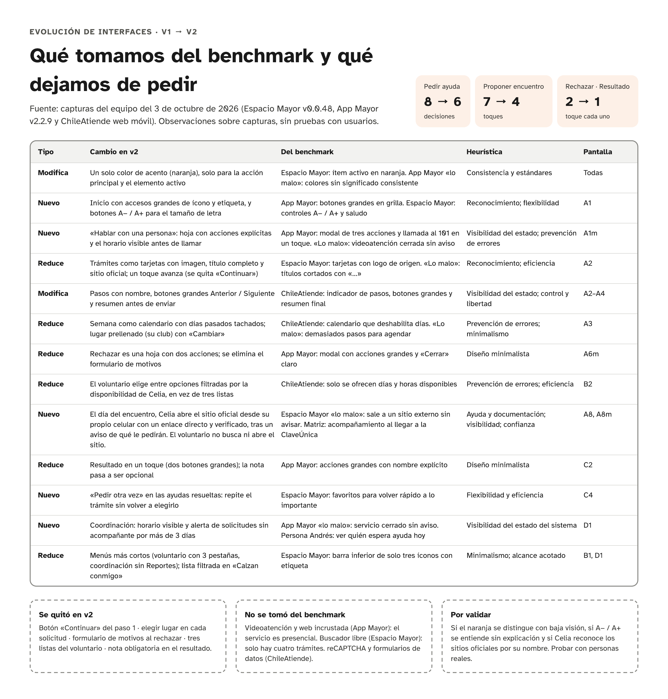

---

## 8. AI Usage Log

The team declares every use of AI assistance and the decisions we made about what it produced. The log is kept by the Designer and covers each member's contributions. It is in [docs/ai-usage-log.md](docs/ai-usage-log.md).

---

## 9. Annex

This section provides direct access to the documents delivered for each project phase.

### 3. Strategy Documents

- **[Value Proposition Canvas](docs/value-proposition-canvas--en.pdf)**
  Pains, gains and jobs of our customer segment, and how our value proposition responds to them
- **[UX Personas](docs/ux-personas-en.pdf)**
  Complete personas with profiles, frustrations, goals, interests and quotes, including the secondary proto-persona (Sofía Morales)
- **[Benchmark](docs/benchmark-en.pdf)**
  Analysis of Espacio Mayor, App Mayor and ChileAtiende, with annotated screenshots and a four-action matrix

### 4. Scope Documents

- **[Customer Journey Map](docs/customer-journey-en.pdf)**
  Journey of the persona Celia Márquez across five stages, with her pains and the solutions in *To the Digital Side*

### 5. Structure Documents

- **[Navigation Flow](docs/navigation-flow-en.pdf)**
  How the older adult, the volunteer and the coordinator move through the screens, and which events connect their lanes
- **[Screen Name Equivalences](docs/screen-names.md)**
  English names used in the navigation flow and their Spanish frame names in Figma

### 6. Skeleton Documents

- **[Low-Fidelity Wireframes](docs/wireframes-low-fi-es.pdf)**
  20 screens (older adult, volunteer and coordinator) plus the component sheet. Text in Spanish.

### 7. Surface Documents

- **[High-Fidelity Wireframes](docs/wireframes-hi-fi-es.pdf)**
  The same 20 screens with visual design, the component sheet and the interface evolution. Text in Spanish.
- **[Interface Evolution](assets/interface-evolution-es.png)**
  One-page sheet: what we took from the benchmark, what we changed and what we stopped asking for

### 8. AI Usage Log

- **[AI Usage Log](docs/ai-usage-log.md)**
  Declaration of AI assistance and the decisions the team made about it

### Secondary proto-persona

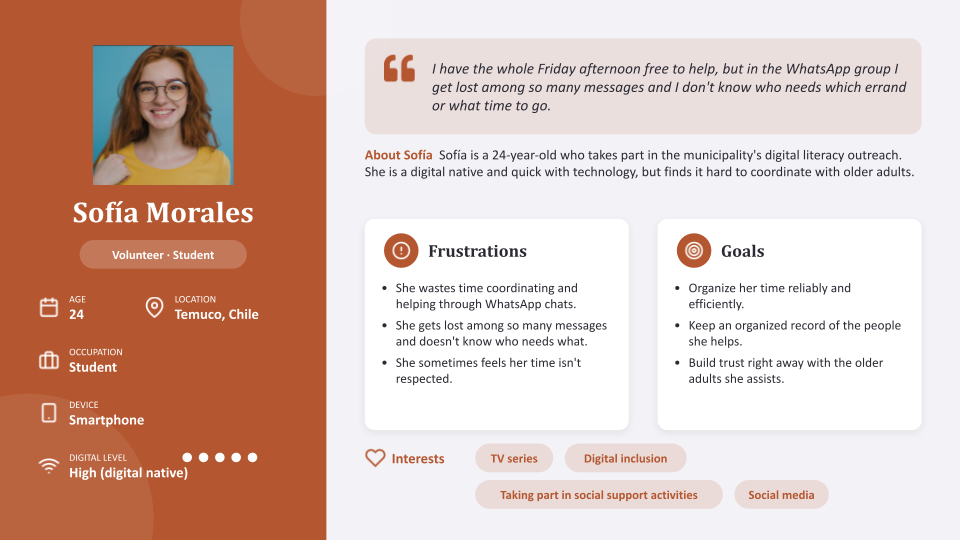

*Sofía Morales, 24, student volunteer.* "I have the whole Friday afternoon free to help, but in the WhatsApp group I get lost among so many messages and I don't know who needs which errand or what time to go."
