# To the Digital Side (Al Lado Digital)
User Experience Design for *To the Digital Side* (*Al Lado Digital* in Spanish)

## Index

- [1. Introduction](#1-introduction)
  - [1.1. The Problem](#11-the-problem)
  - [1.2. Our Solution](#12-our-solution)
- [2. Team & Roles](#2-team--roles)
- [3. Strategy](#3-strategy)
  - [3.1. Value Proposition Canvas](#31-value-proposition-canvas)
  - [3.2. UX Personas](#32-ux-personas)
  - [3.3. Benchmarking](#33-benchmarking)
- [4. Scope](#4-scope)
  - [4.1. Customer Journey Map](#41-customer-journey-map)
- [5. Structure](#5-structure)
  - [5.1. Navigation Structure](#51-navigation-structure)
- [6. Skeleton](#6-skeleton)
  - [6.1. Low-Fidelity Wireframes](#61-low-fidelity-wireframes)
- [7. Surface](#7-surface)
  - [7.1. High-Fidelity Wireframes](#71-high-fidelity-wireframes)
  - [7.2. Interface Evolution](#72-interface-evolution)
- [8. Annex](#8-annex)

---

## 1. Introduction

### 1.1. **The Problem**

> I need to book a doctor's appointment online this week, and my family lives in another city.
> I don't want to give my passwords to a stranger.
> How will I know the errand was actually completed?

Many everyday errands have moved to online channels, and older adults depend on a relative being available to complete them. Peer facilitators and volunteers exist in senior citizens' clubs and municipalities, but coordination is informal and gets lost along the way.

The challenge is well-defined and verifiable: **match a specific need with someone who can help, schedule the meeting, and record whether the errand was resolved**, building trust without exposing the requester's sensitive data.

---

### 1.2. **Our Solution**

**To the Digital Side** (*Al Lado Digital*) is a platform that pairs older adults with trusted peer facilitators or volunteers to complete online errands together: in person, at an agreed time, with confirmation of the outcome, and **without sharing passwords with anyone**.

#### 🤝 **Matching and Scheduling**

- The older adult states the errand and when they are available
- Matching with a **verified** facilitator or volunteer
- Integrated scheduling: date, time and place of the meeting

#### 🔒 **Guided In-Person Assistance**

- The person types their own passwords; the volunteer only accompanies them
- Verified profiles within a limited, known support network

#### ✅ **Traceability**

- A log to verify and mark the **status of each errand**
- Peace of mind through clear, recorded confirmations

#### ♿ **Simple and Accessible Interface**

- Large text, short steps and no long forms

---

## 2. Team & Roles

Vicente Contreras - Project Manager

Nelson Sandoval - UX/UI Designer

Arturo Rivas - UX Researcher / Analyst

---

## 3. Strategy

### 3.1. Value Proposition Canvas

*How we aligned the needs of older adults with our solution*

**Customer segment:** older adults who need to complete errands online and do not always have someone available to help them.

**Identified gaps:**

- **Trust:** the risk of exposing sensitive data or passwords to a stranger.
- **Dependence:** constant reliance on relatives being available.
- **Coordination:** informal arrangements that get lost, causing missed appointments and postponed care.
- **Uncertainty:** not knowing whether the errand was actually completed.

**How the solution responds:**

- **Pain relievers:** passwords are never shared, volunteers have verified profiles, and the support network is limited and known.
- **Gain creators:** peace of mind through recorded confirmations, and the chance to complete the errand on their own with guided assistance.

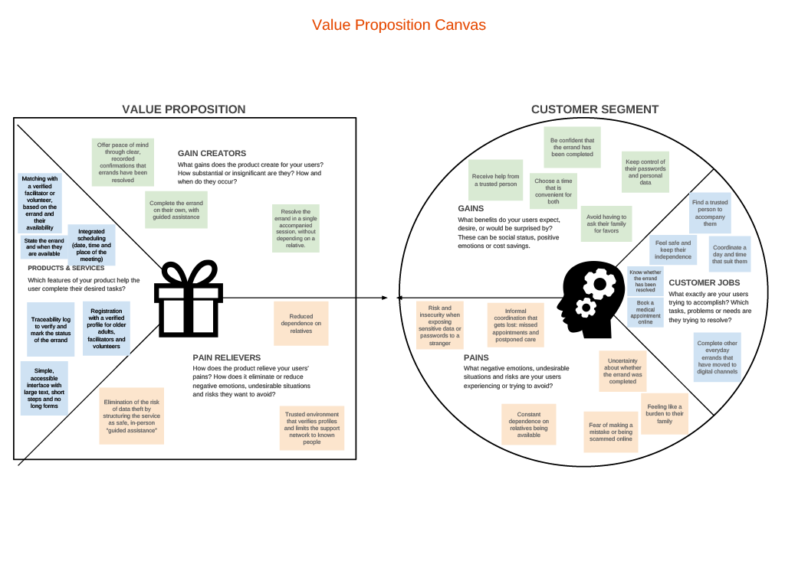

***

### 3.2. **UX Personas**

*Our personas represent the four key roles in the ecosystem: the older adult who requests help, two volunteers with different profiles, and the municipal coordinator. They are proto-personas based on team assumptions, to be validated through interviews.*

---

👥🔹 **Celia Márquez** — Requester, 74, retired  
*"My children live far away and I don't want to bother them every time I need to book an appointment. If someone from the club goes with me, I'll do it myself, but I'm not giving my passwords to just anyone."*

👥🔹 **Roberto Pérez** — Volunteer and club peer facilitator, 67, retired  
*"I learned to use the government portal on my own. If you give me a simple app without so many hoops, I'm happy to go with the other club members to get their things done."*

👥🔹 **Andrés Rivera** — Municipal coordinator, 40  
*"I can't rely on volunteers' good memory. I need to see on a screen how many seniors are waiting for help today and who is taking care of them."*

👥🔹 **Sofía Morales** — Volunteer and student, 24  
*"I have the whole Friday afternoon free to help, but in the WhatsApp group I get lost among so many messages and I don't know who needs which errand or what time to go."*

---

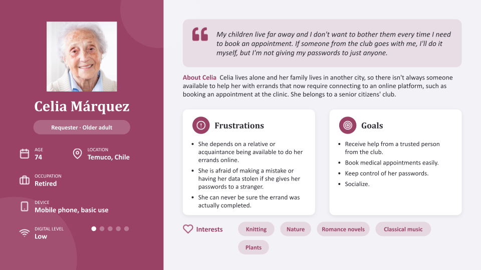

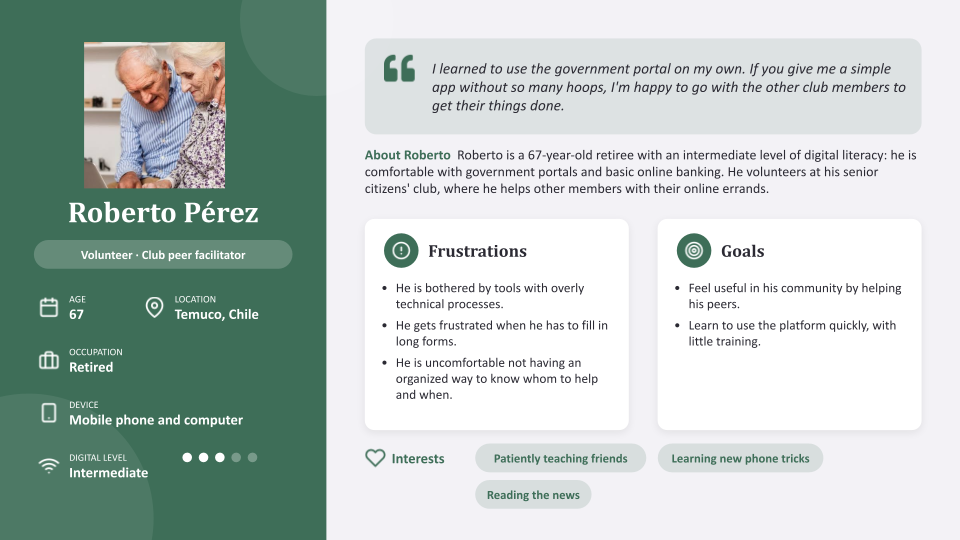

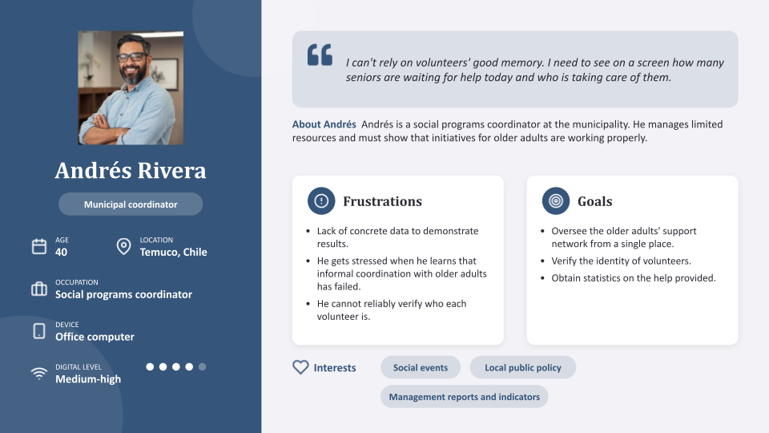

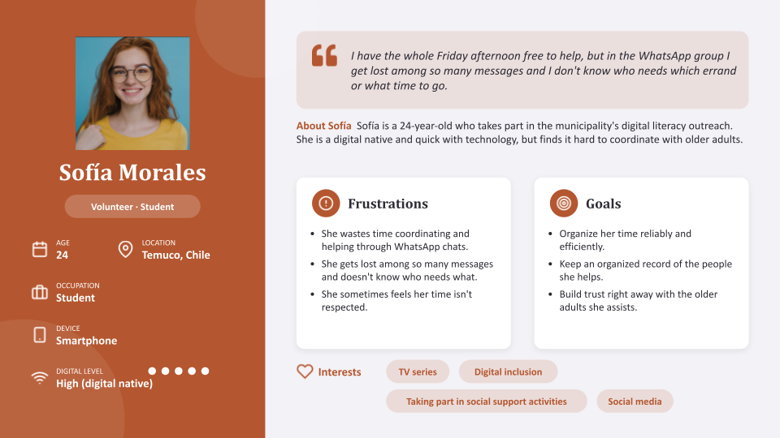

***

### 3.3. Benchmarking

To identify best practices and opportunities for improvement in the design of *To the Digital Side*, we analyzed three existing tools that cover the problem space: older adults completing everyday errands online.

#### Tools analyzed:

- 🎯 **Direct competitor and design reference:** *Espacio Mayor* (Fundación Conecta Mayor UC). A free app that brings procedures, certificates, benefits and public services for older adults into one place. It guides users to those services with simple language, step-by-step tutorials, large text and clear buttons.
- 🧩 **Complementary:** *App Mayor* (Fundación Conecta Mayor UC). An Android app that makes the smartphone easier for older adults, with large buttons, shortcuts to common apps and direct access to ChileAtiende (video call and phone).
- ⚖️ **Analogous:** *ChileAtiende*. The State's service portal, used here through its mobile website. It handles the same kinds of procedures, but for the general population.

All three were analyzed on **October 3, 2026**: Espacio Mayor v0.0.48, App Mayor v2.2.9 and the ChileAtiende mobile website.

#### How we analyzed them

The analysis follows the **four-action model** (Increase, Include, Reduce, Remove). For each tool, we recorded **"the good"** and **"the bad"**, each backed by an annotated screenshot and, for the problems, a usability heuristic.

- **Increase:** large buttons and text, cards with an image and a short description, and a step indicator when booking.
- **Include:** a bottom bar with labeled icons, a one-tap direct call, visible assisted alternatives, and **human support at the moment the user reaches the ClaveÚnica sign-in**, which is what our proposal adds.
- **Reduce:** small text, long paths to reach a service, truncated titles, and small web text inside an app.
- **Remove:** colors with no consistent meaning, leaving for an external site without warning, and discovering that a service is closed only after entering it.

> The tools we analyzed help older adults on their own, through simplified interfaces or through the State's service channels (video call, call center and branches). None of them offers guided help from a trusted peer who accompanies the person while they type their own passwords, and that is the gap *To the Digital Side* addresses.

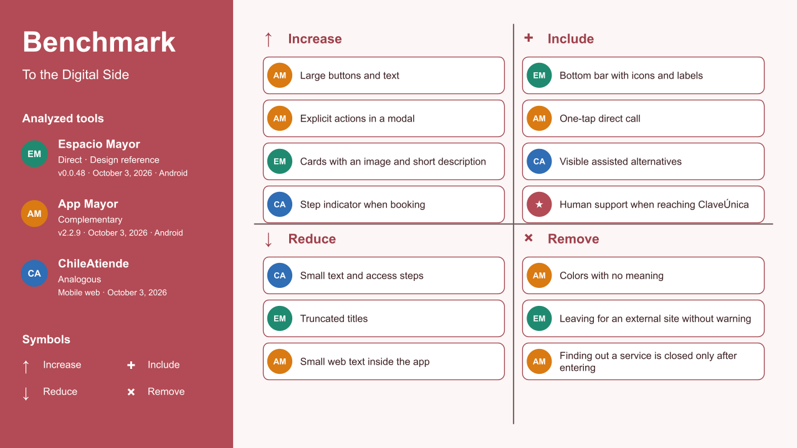

📄 For the complete analysis with annotated screenshots, see the [benchmark document](docs/benchmark-en.pdf).

---

## 4. Scope

### 4.1. Customer Journey Map

We combined the persona **Celia Márquez** with the features of the project to map how she would experience the service, from hearing about it to asking for help again.

**Scenario:** book a doctor's appointment online this week, with help from a club volunteer and without handing over her passwords.

The map follows five stages:

- 🔍 **Awareness:** she hears about the service at her senior citizens' club.
- 🤔 **Consideration:** she checks that the people are verified and trustworthy.
- ✅ **Decision:** she creates her profile and states the errand she needs.
- 🤝 **Delivery & Use:** she meets her facilitator or volunteer, types her own passwords and completes the errand.
- 💬 **Loyalty & Advocacy:** she checks the status of the errand, asks for help again and tells her club peers.

For each stage, the map covers the customer's activities, goals, touchpoints, emotions, pains and the solutions in *To the Digital Side*, as well as the business goal, KPIs, organisational activities, responsible parties and technology systems behind it.

> The emotions and indicators are hypotheses based on proto-personas, to be validated with real users.

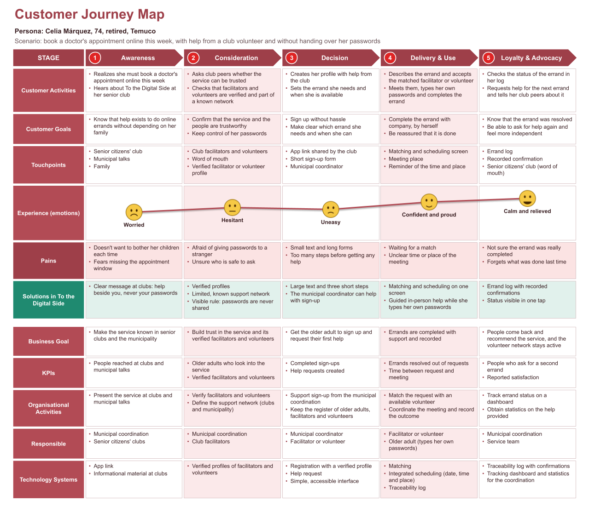

---

## 5. Structure

### 5.1. Navigation Structure

> **Language note:** at our teaching assistant's request, the text inside the wireframes is in **Spanish**. This README describes them in English.

The product is a **mobile app** with three sets of screens, one per role. The older adult and the volunteer each get a bottom bar with **three tabs and a text label under every icon**, a pattern we adopted from Espacio Mayor. The municipal coordinator works from a **desktop view**, because Andrés uses an office computer (a persona assumption).

| Role | Persona | Platform | Main navigation |
|---|---|---|---|
| Older adult (requester) | Celia Márquez | Mobile | *Inicio* (Home) · *Mis ayudas* (My errands) · *Ayuda* (Help) |
| Volunteer / peer facilitator | Roberto Pérez, Sofía Morales | Mobile | *Solicitudes* (Requests) · *Mi agenda* (My schedule) · *Mi perfil* (My profile) |
| Municipal coordinator | Andrés Rivera | Desktop | *Hoy* (Today) · *Solicitudes* (Requests) · *Personas y verificación* (People and verification) |

**Main paths** (screen codes match the wireframes in sections 6 and 7):

1. **Older adult: ask for help and accept a companion.** `A1` Home → `A2` Choose the errand → `A3` Choose days and time → `A4` Review and send → `A5` Request sent → `A6` Accept the proposed meeting (or `A6m` ask for someone else) → `A7` Meeting confirmed → `A8` Day of the meeting → `A8m` Notice before leaving for the official site. `A1m` (talk to a person) opens from Home, and the same help option appears on the day-of-meeting screen.
2. **Volunteer: propose a meeting and report the result.** `B1` Requests from the network → `B2` Propose a meeting → `B3` My schedule → `C1` Meeting → `C2` How did it go?
3. **Older adult: confirm the result.** When the volunteer reports the result (resolved or needs follow-up), `C3` asks Celia to confirm it; either answer leads to `C4` My errands, where "ask again" reopens `A3`.
4. **Coordinator: follow up on cases.** `D1` Coordination dashboard ↔ `D2` Case detail. The dashboard lists the requests from every lane and their status; in the prototype it has no links to or from the mobile screens.

We drew the **navigation flow** first, to decide which wireframes to design, and then designed one wireframe for every box. Following the flow, each role has its own lane, time runs from top to bottom, and the lanes line up so that you can see what each person sees at the same moment (for example, when Celia sends a request, it appears in the volunteer's list).

- **Solid arrows** are things a person taps. **Dashed arrows** are system events or actions by someone else (a proposal arriving, the agenda updating). They are not taps; in Figma, some of them are "(Prototipo)" shortcuts.
- Every solid arrow matches a link in the Figma prototype. Back buttons, "Volver al inicio" and the tab bars are listed in the diagram's notes rather than drawn.
- **Pink boxes** mark the *trust moments*: the screens that announce what an official site will ask for and make clear that the person types their own passwords.
- **Yellow dashed boxes** are outside the wireframes: sign-up and login, and the official site that opens outside the app.

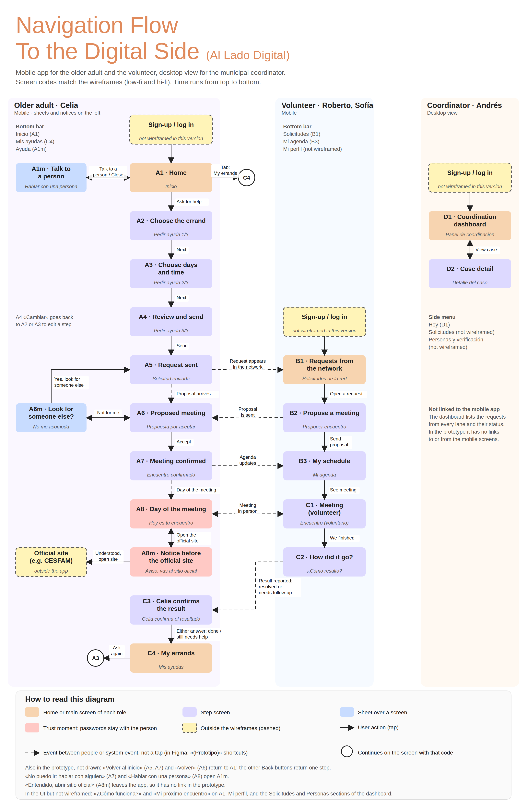

📄 For the diagram as a document, see the [navigation flow (PDF)](docs/navigation-flow-en.pdf).

🔤 The diagram names each screen in English, while the wireframes are in Spanish. The [screen name equivalences](docs/screen-names.md) match every English name with its Spanish frame in Figma, using the shared screen code.

> The flow was read from the buttons and links in the wireframes. Screens marked "(Prototipo)" in Figma are shortcuts used to move between states in the mockup; in the real product, those transitions happen on their own (for example, a proposal arriving). Sign-up and login are shown but not wireframed in this version.

---

## 6. Skeleton

### 6.1. Low-Fidelity Wireframes

The low-fidelity wireframes fix **layout, hierarchy and content** before any visual styling. They are grayscale, use real Spanish text, and cover **20 screens** plus a component sheet:

- **Older adult (A1–A8m, 11 screens):** home with large shortcuts and A– / A+ text-size buttons, talking to a person, a three-step request (errand, days, review), request sent, accepting or declining a proposed meeting, confirmed meeting with a checklist of what to bring, and the day-of-meeting guide.
- **Volunteer (B1–C2, 5 screens):** requests from the network, proposing a day and time, personal schedule, guided meeting and a one-tap outcome ("Resolved" or "Needs follow-up").
- **Older adult, after the meeting (C3–C4, 2 screens):** confirming the outcome and the list of errands, with "ask again".
- **Coordinator (D1–D2, 2 desktop screens):** a dashboard with requests waiting, and a case detail with history and coordination actions.

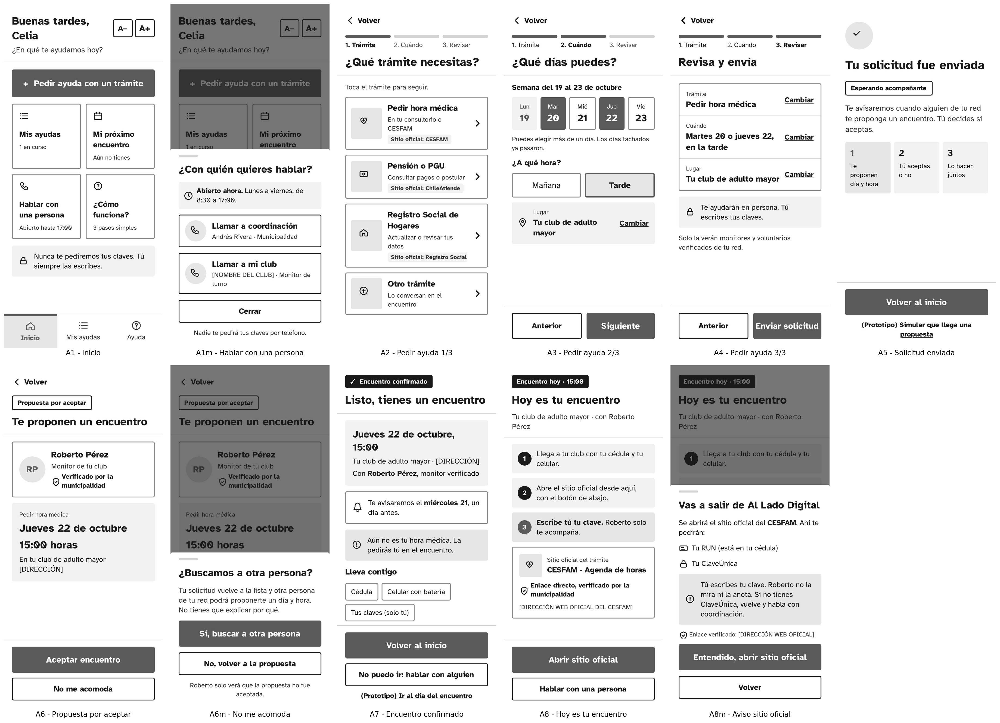

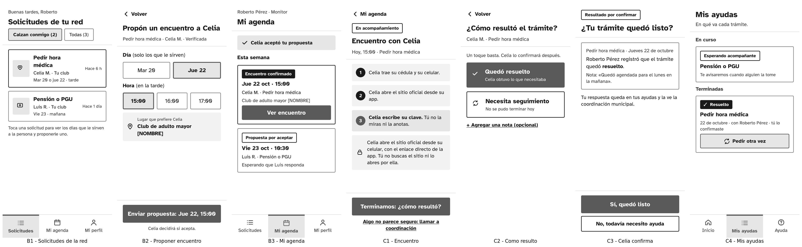

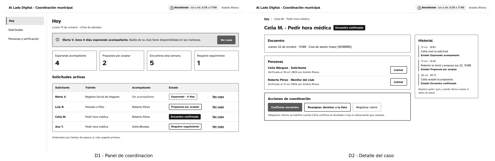

📄 All screens and the component sheet: [low-fi wireframes (PDF)](docs/wireframes-low-fi-es.pdf)
🎨 Figma file: [Low-fi wireframes](https://www.figma.com/design/iuQ3Dh1TUHm5OsJF83BBEb/al-lado-digital__low-fi-wireframes)

---

## 7. Surface

### 7.1. High-Fidelity Wireframes

The high-fidelity version applies visual design to the same 20 screens. The design decisions that carry the most weight:

- **One accent color (orange), used only for the main action and the active item.** Everything else is neutral, so color always means the same thing (a problem we recorded in App Mayor).
- **Large text and buttons, with a text-size control (A– / A+) on the home screen.**
- **A reassurance about passwords on every sensitive screen:** "We will never ask for your passwords. You always type them yourself."
- **Official sites are named and announced before leaving the app** (`A8`, `A8m`): the screen says which site opens, what it will ask for (national ID and ClaveÚnica) and that the volunteer only accompanies.
- **Verified volunteers** show a "Verified by the municipality" badge (`A6`).

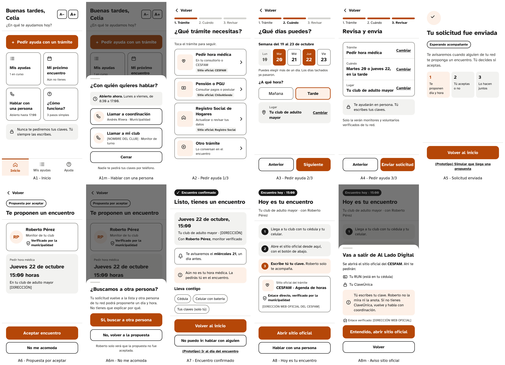

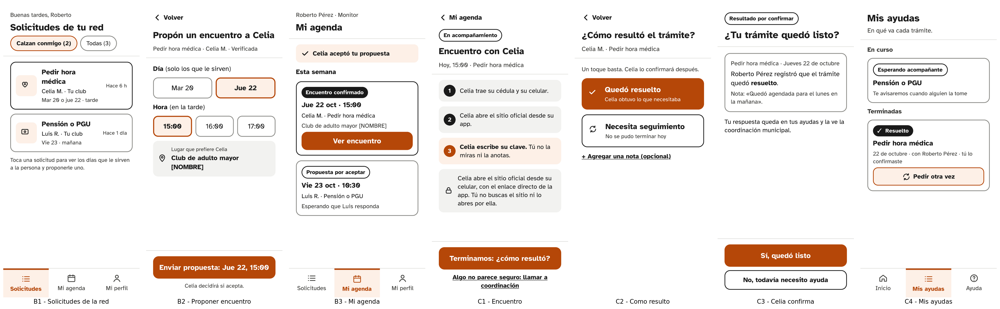

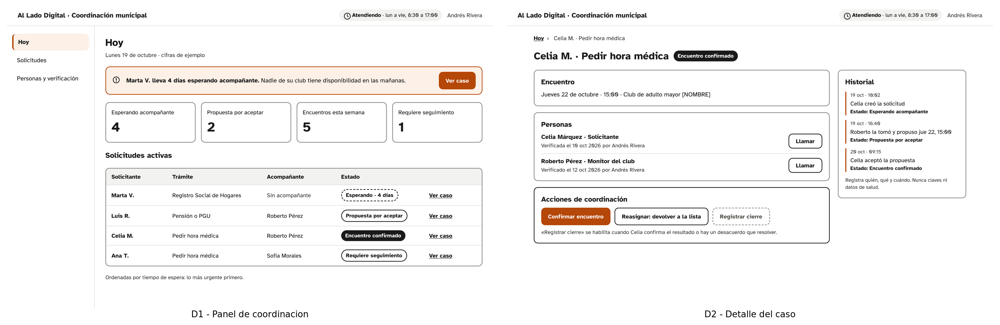

📄 All screens and the component sheet: [high-fi wireframes (PDF)](docs/wireframes-hi-fi-es.pdf)
🎨 Figma file: [High-fi wireframes](https://www.figma.com/design/nFXlK3JkbD5MW7fky4NOvt/al-lado-digital__hd)

> The data on the screens (names, dates and figures) are examples. Some fields still show placeholders such as *[DIRECCIÓN]* and *[NOMBRE DEL CLUB]*.

### 7.2. Interface Evolution

Between version 1 and version 2 of the interfaces we compared our screens with what the benchmark showed, and recorded **what we took, what we changed and what we stopped asking for**. According to the team's own count, the changes reduced the steps to ask for help from 8 decisions to 6 and the steps to propose a meeting from 7 taps to 4, and rejecting a proposal or reporting a result now takes one tap each.

> These figures come from the team's own count on the version 1 and version 2 screens. **They have not been tested with users.** What is still to validate with real older adults who match our personas: whether the orange accent stands out for people with low vision, whether A– / A+ is understood without explanation, and whether they recognize the official sites by name.

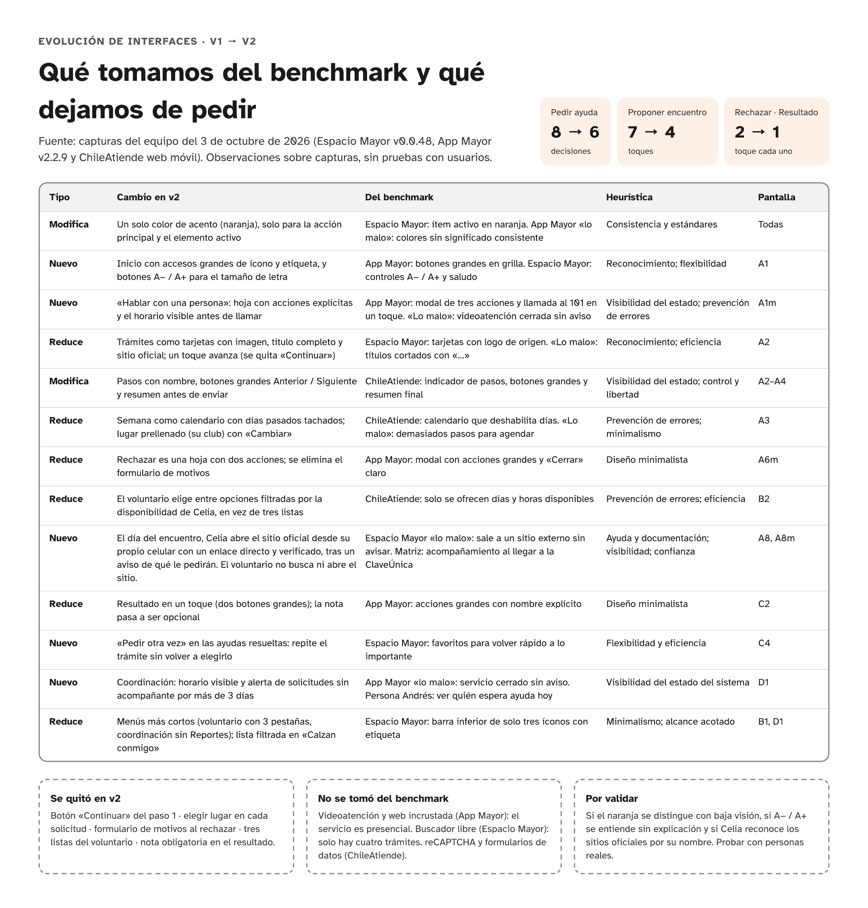

---

## 8. Annex

This section provides direct access to the documents delivered for each project phase.

### 3. Strategy Documents
- 📄 **[Value Proposition Canvas](docs/value-proposition-canvas--en.pdf)**  
 Pains, gains and jobs of our customer segment, and how our value proposition responds to them
- 📄 **[UX Personas](docs/ux-personas-en.pdf)**  
 Complete personas with profiles, frustrations, goals, interests and quotes
- 📄 **[Benchmark](docs/benchmark-en.pdf)**  
 Analysis of Espacio Mayor, App Mayor and ChileAtiende, with annotated screenshots and a four-action matrix

### 4. Scope Documents
- 📄 **[Customer Journey Map](docs/customer-journey-en.pdf)**  
 Journey of the persona Celia Márquez across five stages, with her pains and the solutions in *To the Digital Side*

### 5. Structure Documents
- 📄 **[Navigation Flow](docs/navigation-flow-en.pdf)**  
 How the older adult, the volunteer and the coordinator move through the screens, and which events connect their lanes
- 🔤 **[Screen Name Equivalences](docs/screen-names.md)**  
 English names used in the navigation flow and their Spanish frame names in Figma

### 6. Skeleton Documents
- 📄 **[Low-Fidelity Wireframes](docs/wireframes-low-fi-es.pdf)**  
 20 screens (older adult, volunteer and coordinator) plus the component sheet. Text in Spanish.

### 7. Surface Documents
- 📄 **[High-Fidelity Wireframes](docs/wireframes-hi-fi-es.pdf)**  
 The same 20 screens with visual design, the component sheet and the interface evolution. Text in Spanish.

---
